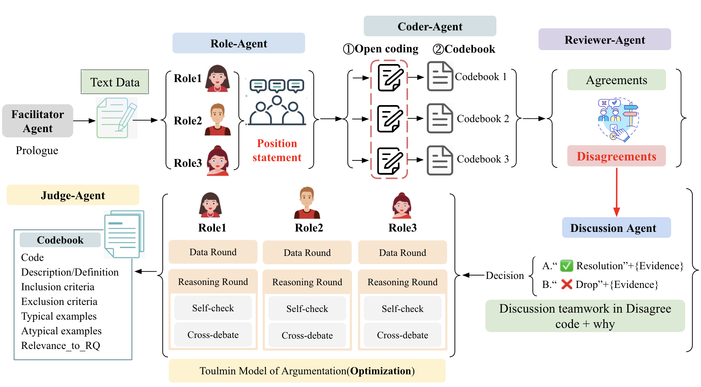

# PerspectiveCoder-LM: A LLM-based Multi-perspective-agent System for Large-scale Corpus Inductive Coding Analysis 
| [**Paper**]()|

We propose PerspectiveCoder-LM, an LLM-based multi-perspective-agent system for large-scale inductive coding, which generates qualitative research codebooks with multi-agent large language model discussions by simulating multiple perspectives. PerspectiveCoder-LM assigns specialised tasks to each agent, such as role-generating multi-perspective positionality statements, inductive coding, review agreements/disagreements of codebooks, and discussion codebooks.

<p align="center">
  <sub>System Introduction</sub>  
</p> 

<p align="center">
  <a href="https://latitude.so/developers?utm_source=github&utm_medium=readme&utm_campaign=prompt_repo_sponsorship" target="_blank">
    
  </a>
</p>

## Contents

- [Introduction](#Introduction) [Project Management](https://docs.google.com/document/d/1yQeDEgtlWTl9SLAgr3bBJ9_l59sWQwWXsGzLFwkRVKY/edit?tab=t.utp4mklu2c15)
- [Install](#install)
- [Model Configuration](#model-configuration)
- [Local Model](#local-model)
- [Evaluation](#evaluation)
# Introduction


### LLM-based Multi-agent System 
| Agent | Description|
| --- | --- | 
| Facilitator-Agent | Provide a **Prologue** for (human-AI interaction system): introduce the workflow, set the stage, or remind all agents of their roles and so on|
| Role-Agent | Generate a **Positionality Statement** for every role to simulate the multi-perspective coding(Identity, Academic Level, Discipline, Research Interests, Biases/Assumptions, etc.)|
| Coder-Agent | For each role: Use the Positionality Statement to perform **Open Coding**, generate a full **initial codebook from every role**. |
| Reviewer-Agent | Review all **Codebook-Agreements/Disagreements** from the three role-generating initial codebooks|
| Discussion-Agent | Combine their disagreements, start the **discussion process** |
| Judge-Agent | **Decide what codes remain or are dropped** and produce the final codebook|

### Experiments and Analysis
#### Datasets
1. Scrum-[How Scrum Adds Value to Achieving Software Quality?](https://zenodo.org/records/6624064)
2. StoryPerceptions-[StoryPerceptions (EMNLP 2024): crowd “perceptions” + inductively derived code taxonomy + annotator demographics](https://maria-antoniak.github.io/resources/2024_emnlp_story_perceptions.pdf)
3. [Towards Designing a QA Chatbot for Online News (arXiv 2312.10650): open-coded question taxonomy + OSF release](https://ar5iv.labs.arxiv.org/html/2312.10650)
4. [The HaLLMark Effect (arXiv 2311.13057): open-coded policy recommendations + “coded policies” released on OSF](https://ar5iv.labs.arxiv.org/html/2311.13057)
6. [Social Bias Frames](https://maartensap.com/social-bias-frames/)
7. [Social Chemistry](https://maxwellforbes.com/social-chemistry/)
#### Codebook Format

#### Study 1: 
1. [Scrum-results](Data/Scrum-interviews/gpt-4o_output/)

| Baseline | Description | Results|
| --- | --- | --- |
| Baseline1 | Single LLM + no perspective+ no discussion | [RQ1](Data/Scrum-interviews/gpt-4o_output/rq1/baseline1/excel/baseline1.xlsx), [RQ2](Data/Scrum-interviews/gpt-4o_output/rq2/baseline1/excel/baseline1.xlsx) |
| Baseline2 | Three LLM + the same setting perspective of three roles with PerspectiveCoder-LM + no discussion | [RQ1](Data/Scrum-interviews/gpt-4o_output/rq1/discuss_process/excel/baseline2.xlsx), [RQ2](Data/Scrum-interviews/gpt-4o_output/rq2/discuss_process/excel/baseline2.xlsx) |
| PerspectiveCoder-LM |the perspective of three roles+ discussion process | [RQ1](Data/Scrum-interviews/gpt-4o_output/rq1/discuss_process/excel/discuss.xlsx), [RQ2](Data/Scrum-interviews/gpt-4o_output/rq2/discuss_process/excel/discuss.xlsx) |

2. [StoryPerceptions-results](Data/StorySeeker/gpt-4o_output/)

| Baseline | Description | Results|
| --- | --- | --- |
| Baseline1 | Single LLM + no perspective+ no discussion | [Goal](Data/StorySeeker/gpt-4o_output/goal/baseline1/excel/baseline1.xlsx), [Rationale](Data/StorySeeker/gpt-4o_output/rationale/baseline1/excel/baseline1.xlsx) |
| Baseline2 | Three LLM + the same setting perspective of three roles with PerspectiveCoder-LM + no discussion | [Goal](Data/StorySeeker/gpt-4o_output/goal/discuss_process/excel/baseline2.xlsx), [Rationale](Data/StorySeeker/gpt-4o_output/rationale/discuss_process/excel/baseline2.xlsx) |
| PerspectiveCoder-LM |the perspective of three roles+ discussion process | [Goal](Data/StorySeeker/gpt-4o_output/goal/discuss_process/excel/discuss.xlsx), [Rationale](Data/StorySeeker/gpt-4o_output/rationale/discuss_process/excel/discuss.xlsx) |

## *Install*
### Features
- Multi-agent coding, review, discussion, and final adjudication.
- Single-agent and shared-positionality baselines.
- API models and local Hugging Face models.

### Project Layout
```
PerspectiveCoder-LM/
├── main.py                 # CLI entry point (discuss & baseline flows)
├── config/                 # Model settings, positionality, and prompts
├── Data/                   # Source interviews and processed datasets
├── models/                 # Model download script and local weights
├── evaluate/               # Code matching and evaluation
├── utils/                  # Core agent orchestration utilities
└── run_experiments.sh      # Scrum and StorySeeker experiments
```

### Requirements
- Python 3.10+
- PyTorch and dependencies listed in `requirements.txt`
- For API models, configure credentials and endpoints in `config/model_menu.py`

```bash
pip install -r requirements.txt
```

### Model Configuration
Add or update model settings at the end of `config/model_menu.py`:

```python
import os

model_name = "gpt-4o"
api_key[model_name] = os.getenv("OPENAI_API_KEY")
base_url[model_name] = None  # Or your provider's API base URL.
llm_MaxToken[model_name] = 128000
MODEL_TOKENIZER_MAP[model_name] = "cl100k_base"
if model_name not in available_models:
    available_models.append(model_name)
```

Set the key before running:

```bash
export OPENAI_API_KEY="YOUR_API_KEY"
```

For another API model, change the name, endpoint, context limit, and tokenizer encoding, then pass the same name to `-m`. Local models use their directory path and do not require entries in `model_menu.py`.

### Command-Line Usage
Run from the project root:

```bash
python main.py \
  -i "Data/Scrum-interviews/processed/First Cycle - RQ1.json" \
  -o Data/Scrum-interviews/gpt-4o_output/rq1 \
  -c config/config.json \
  -m gpt-4o \
  -rq Data/Scrum-interviews/processed/rq1.txt \
  -exp 0
```

Use `-rq None` to run without a research question.

### Local Model
Download the model:

```bash
python models/download_model.py \
  --model-id Qwen/Qwen2.5-1.5B-Instruct \
  --model-dir models/Qwen2.5-1.5B-Instruct
```

Pass the downloaded directory to `-m`:

```bash
python main.py \
  -i "Data/Scrum-interviews/processed/First Cycle - RQ1.json" \
  -o Data/Scrum-interviews/Qwen2.5-1.5B-Instruct_output/rq1 \
  -m models/Qwen2.5-1.5B-Instruct \
  -rq Data/Scrum-interviews/processed/rq1.txt \
  -exp 0
```

### Parser Arguments

| Flag | Default | Description |
| --- | --- | --- |
| `-i`, `--input-file` | `Data/Scrum-interviews/processed/First Cycle - RQ1.json` | JSON records with `participant` and `data_chunk`; existing `code` labels are excluded from prompts. |
| `-o`, `--output-dir` | `Data/Scrum-interviews/gpt-4o_output/rq1` | Experiment output directory. |
| `-c`, `--config-dir` | `config/config.json` | Agent prompts and discussion settings. |
| `-m`, `--model-name` | `gpt-4o` | API model name or local model directory. |
| `-rq`, `--research-question` | `Data/Scrum-interviews/processed/rq1.txt` | UTF-8 TXT file path, or `None`. |
| `-exp`, `--experiment-name` | `2` | `0`: discussion with different positionalities; `1`: single-agent baseline; `2`: discussion with shared positionality. |

### Experiment Outputs
Paths relative to `--output-dir`:

| Experiment | JSON Output |
| --- | --- |
| `0` | `discuss_process/json/discuss.json` |
| `1` | `baseline1/json/baseline1.json` |
| `2` | `discuss_process/json/baseline2.json` |

### Batch Experiments
Run all Scrum and StorySeeker experiments and export Excel files:

```bash
bash run_experiments.sh
```

Results are saved under `Data/<dataset>/gpt-4o_output/<task>/`.

### Evaluation
After completing the experiments, extract code lists and evaluate:

```bash
python Data/extract_final_codes.py --model-name gpt-4o
python evaluate/evaluate.py
```

Extraction produces `discuss_codes.jsonl`, `baseline1_codes.jsonl`, and `baseline2_codes.jsonl`. The evaluator currently uses `discuss_codes.jsonl`, matching records to GT by `name`.

| Dataset | Ground Truth |
| --- | --- |
| Scrum-interviews | `Data/Scrum-interviews/processed/rq_gt.jsonl` |
| StorySeeker | `Data/StorySeeker/processed/ground_truth.jsonl` |

Code matching uses `sentence-transformers/all-MiniLM-L6-v2` (downloaded on first use), with similarity `(cosine + 1) / 2` and threshold `0.7`.

| Metric | Calculation |
| --- | --- |
| Recall | Matched GT codes / total GT codes |
| Match rate | Matched generated codes / total generated codes |
| Code diversity | Greedy similarity groups / total generated codes |

Results: `Data/<dataset>/gpt-4o_output/discuss_evaluation.jsonl`. For other models, change `--model-name` during extraction and `model_name` in `evaluate/evaluate.py`; `threshold` and `device` are set there too.

## License
The repository inherits its license terms from `PerspectiveCoder-LM`. Add explicit licensing information here if required.
